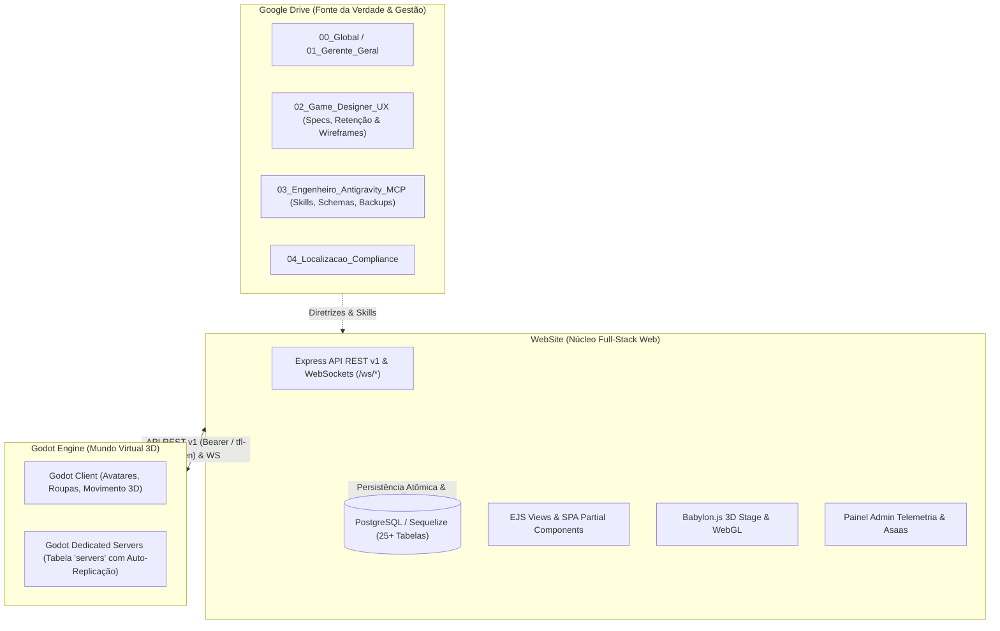

# The Fantasy Life (TFL) — Árvore Completa do Projeto e dos Módulos
**Data de Compilação:** 2026-10-13  
**Repositório Base:** `/media/not/Projetos/WebSite`  
**Base de Conhecimento do Agente:** `docs/agent_knowledge/`  
**Ambientes Integrados:** Web Full-Stack (`WebSite`), Godot 3D Engine (`godot/tfl-1`) e Google Drive (`GoogleDrive/The fantasy life Project/`).

---

## 1. Visão Geral da Arquitetura do Ecossistema



---

## 2. Árvore Estrutural Física do Repositório WebSite

```text
/media/not/Projetos/WebSite/
├── app.js                          # Configuração do Express, middlewares globais, sessions e i18n
├── server.js                       # Bootstrap HTTP, inicialização de WebSockets (/ws/chat, /ws/game) e DB
├── package.json                    # Dependências (Express, Sequelize, pg, ws, ejs, etc.)
├── PROJECT_MEMORY_LOG.txt          # Memória contínua e logs de auditoria de todos os modelos de IA
├── .agent/
│   └── rules/
│       └── project-memory.md       # Regras mandatórias de leitura e atualização de memória
│
├── docs/                           # Central de Documentação do Projeto
│   ├── agent_knowledge/            # 📁 Base de Conhecimento Exclusiva do Agente
│   │   ├── README.md               # Índice da base de conhecimento do agente
│   │   └── ARVORE_PROJETO_E_MODULOS.md # Esta árvore completa de arquivos e módulos
│   ├── PROJECT_ARCHITECTURE_AND_API.md # Documentação da API REST v1 e esquemas de dados
│   └── project_drive/              # Réplica/espelho de diretrizes dos departamentos do Drive
│       ├── 00_Global/
│       ├── 01_Gerente_Geral/
│       ├── 02_Game_Designer_UX/
│       └── 03_Engenheiro_Antigravity_MCP/
│
├── src/
│   ├── api/
│   │   └── v1/                     # Endpoints da API REST v1 (consumidos por Web, Godot e Mobile)
│   │       ├── bank/               # Endpoints de carteira, transferências e financeiro
│   │       │   └── index.js
│   │       ├── game/               # Endpoints de salas 3D, servidores e inventário
│   │       │   └── index.js
│   │       ├── social/             # Endpoints do feed, comentários, reações e diário
│   │       │   └── index.js
│   │       ├── old/                # Integrações legadas e cliente Asaas v3
│   │       │   ├── assas_client.js
│   │       │   └── bank_controller.js
│   │       └── index.js            # Roteador mestre da API v1 com autenticação universal
│   │
│   ├── controllers/                # Controladores da aplicação
│   │   ├── admin/
│   │   │   ├── index.js            # Painel admin, métricas, bots e regras econômicas
│   │   │   └── routers.js          # Roteamento de páginas administrativas (/admin/assas, etc.)
│   │   ├── auth.js                 # Login, cadastro, recuperação de senha e seleção de conta
│   │   ├── game/
│   │   │   ├── avatar/             # Controladores de inventário e guarda-roupa
│   │   │   ├── cloth_controllers.js
│   │   │   ├── outfit_controller.js
│   │   │   ├── rooms_controllers.js# CRUD de salas 3D e passe de entrada
│   │   │   ├── server_controller.js# Gestão de instâncias replicadas na tabela 'servers'
│   │   │   └── shop/               # Loja 3D independente e catálogo
│   │   ├── profile/
│   │   │   └── profile_controller.js # Orquestrador mestre do portal /profile e suas rotas SPA
│   │   └── social/
│   │       └── chat_controller.js  # Chat Global, DMs, Grupos e WebSocket /ws/chat
│   │
│   ├── locales/                    # Sistema de Internacionalização (i18n)
│   │   ├── i18n.js                 # Middleware de detecção de idioma e renderização
│   │   ├── pt-BR.json              # Idioma principal e fallback oficial
│   │   ├── en-US.json              # Inglês
│   │   └── es-ES.json              # Espanhol
│   │
│   ├── models/                     # Modelos Sequelize (PostgreSQL)
│   │   ├── bank/
│   │   │   ├── CoinOrder.js        # Ordens de compra/venda P2P (Bolsa de moedas)
│   │   │   ├── CurrencyRegister.js # Registro histórico de saldos
│   │   │   ├── PaymentBank.js      # Transações bancárias e Pix
│   │   │   ├── PaymentWebHook.js   # Histórico de webhooks recebidos do gateway
│   │   │   └── PlatformOperationalExpense.js # Despesas operacionais para cálculo de solvência
│   │   ├── game/
│   │   │   ├── AvatarCareerModel.js# Trilhas de carreiras e selos colecionáveis
│   │   │   ├── AvatarModel.js      # Avatares, bio, gênero e privacidades granulares
│   │   │   ├── AvatarOutfit.js     # Peças 3D vestidas no esqueleto do avatar
│   │   │   ├── AvatarOutfitStyle.js# Presets de looks (até 10 por avatar)
│   │   │   ├── CurrencyModel.js    # Carteira multi-moeda (Cash, Coins, Chips, Pix, PIN)
│   │   │   ├── EconomyRuleModel.js # Tabela centralizada de taxas e regras econômicas
│   │   │   ├── inventory.js        # Inventário de roupas 3D do avatar
│   │   │   ├── ObjectModel.js      # Objetos instanciados nas salas 3D
│   │   │   ├── PrefabModel.js      # Modelos 3D base carregados da engine
│   │   │   ├── RoomModel.js        # Salas virtuais, capacidade e passes de entrada
│   │   │   ├── ServerModel.js      # Instâncias de servidores dedicados online
│   │   │   ├── ShopContainer.js    # Catálogo da loja 3D com slots e preços
│   │   │   ├── TerrainModel.js     # Terrenos das salas 3D
│   │   │   ├── TextureModel.js     # Texturas customizadas UGC enviadas por usuários
│   │   │   └── associations.js     # Mapeamento de chaves estrangeiras e relacionamentos
│   │   ├── social/
│   │   │   ├── AvatarMatch.js      # Sistema de Crush/Match mútuo 💘
│   │   │   ├── ChatGroup.js        # Grupos de bate-papo
│   │   │   ├── ChatMessage.js      # Mensagens de chat, fotos, áudios e convites de salas
│   │   │   ├── Comment.js          # Comentários hierárquicos e recursivos
│   │   │   ├── Follower.js         # Grafo de seguidores
│   │   │   ├── Friend.js           # Lista de amigos e solicitações
│   │   │   ├── Ignore.js           # Bloqueios e silenciamentos
│   │   │   ├── Like.js             # 7 Reações empáticas (post, foto, sala, reel, comentário)
│   │   │   ├── MiniReel.js         # Mini Reels (24h) e Sentimentos (6h)
│   │   │   ├── Photo.js            # Galeria de fotos com lightbox
│   │   │   └── Post.js             # Publicações no feed social
│   │   ├── User.js                 # Conta mestre do jogador (e-mail, senha, role)
│   │   └── index.js                # Conexão Sequelize, hooks e exportação central
│   │
│   ├── repositories/
│   │   └── repository.js           # Camada de abstração e consultas especializadas
│   │
│   ├── routes/
│   │   └── router.js               # Roteador principal (/profile, /admin, /api/v1, /tutorial, etc.)
│   │
│   ├── services/
│   │   ├── avatarCareer.service.js # Lógica de XP, níveis e equipagem de selos
│   │   ├── coinMarket.service.js   # Economia P2P, conversor, taxas e livro de ofertas
│   │   ├── diary.service.js        # Diário secreto, desabafo anônimo e leitura premiada
│   │   ├── financialHealth.service.js # Auditoria do passivo de Cash dos jogadores vs despesas
│   │   ├── nameGenerator.service.js# Gerador randômico de nomes para avatares e salas
│   │   ├── shop3d.service.js       # Regras anatômicas da loja 3D, slots, cores e presets
│   │   ├── stats.service.js        # Telemetria de visitas, cache 60s, fuso horário e estatísticas
│   │   └── storage.service.js      # Armazenamento e proxy seguro de imagens (/profile/media/:id)
│   │
│   └── views/                      # Camada de Apresentação (Templates EJS e HTML)
│       ├── admin/
│       │   ├── assas.html          # Central financeira completa com integração Asaas
│       │   └── index.html          # Dashboard administrativo dinâmico (gráficos, bots, economia)
│       ├── partials/
│       │   ├── footer.ejs          # Rodapé unificado: /tutorial, #langSelect e beacon de telemetria
│       │   └── header.ejs          # Menu superior minimalista (Início, Perfil, Sobre, Contato)
│       ├── profile/
│       │   ├── index.ejs           # Shell principal SPA do portal do jogador
│       │   └── partials/           # Módulos carregados sob demanda via fetch (/profile/partial/:id)
│       │       ├── modals.ejs      # Modais globais (inspeção, convites, confirmações)
│       │       ├── sidebar.ejs     # Navegação lateral por ícones e rodapé de idiomas
│       │       ├── view-account.ejs# Configurações de conta, senha e segurança
│       │       ├── view-avatar.ejs # Guarda-roupa 3D, manequim, slots e palco Babylon.js
│       │       ├── view-cassino.ejs# Jogos rápidos de Chips (Slots, Roleta, Dados)
│       │       ├── view-chat.ejs   # Interface do Chat Global, DMs, Grupos e Convites de Sala
│       │       ├── view-diary.ejs  # Folha de caderno tátil, cantinho anônimo e leitura premiada
│       │       ├── view-friends.ejs# Gestão de amigos, pedidos pendentes e match
│       │       ├── view-market.ejs # Saldos, extrato ledger, conversor, compra Pix e bolsa P2P
│       │       ├── view-salas.ejs  # Minhas salas, explorar salas públicas, passes e boost 24h
│       │       ├── view-shop.ejs   # Loja 3D completa com 7 subpáginas e criação UGC
│       │       ├── view-social.ejs # Feed de posts, mini reels 24h, sentimentos 6h e fotos
│       │       ├── view-user-profile.ejs # Perfil social público com privacidades descentralizadas
│       │       └── view-vip.ejs    # Planos de assinatura VIP e ativação de cotas
│       └── tutorial.ejs            # Guia amigável exclusivo para jogadores (sem dados técnicos)
│
├── public/                         # Arquivos Estáticos Servidos ao Navegador
│   ├── css/
│   │   ├── admin.css               # Estilos do painel de administração
│   │   ├── style.css               # Estilos gerais da plataforma
│   │   └── toast.css               # Estilos dos balões de notificação flutuantes
│   ├── js/
│   │   ├── profile/
│   │   │   ├── avatar-rooms.js     # Lógica de manequim 3D, salas, passes e boosts
│   │   │   ├── core.js             # Shell SPA, navegação entre partials e troca de avatar
│   │   │   ├── diary.js            # Interação com o diário, cronômetro de leitura e reações
│   │   │   ├── friends-chat.js     # WebSocket de chat, gravador de áudio e convites de sala
│   │   │   ├── market.js           # Operações financeiras, extrato e bolsa P2P
│   │   │   ├── shop.js             # Controlador da loja 3D, carrinho, preview e texturas
│   │   │   ├── social.js           # Feed, reações, comentários recursivos, fotos e reels
│   │   │   └── stage3d-babylon.js  # Renderização do palco 3D do avatar em WebGL
│   │   └── toast.js                # Plugin oficial de notificações (window.showToast)
│   └── uploads/                    # Diretório local para uploads de mídias e texturas
│
└── scripts/
    └── bot_simulator.js            # Simulador autônomo de múltiplos bots para testes de carga
```

---

## 3. Árvores Modulares Detalhadas (Os 18 Módulos do Sistema)

Abaixo, cada módulo está decomposto em sua árvore hierárquica completa: Dados (Postgres), Lógica (Services), Controle (Rotas/APIs/WS) e Apresentação (Views/JS).

```
================================================================================
MÓDULO 01: AUTENTICAÇÃO, CONTAS & SEGURANÇA (User)
================================================================================
├── DADOS (PostgreSQL / Sequelize)
│   └── User.js (tabela: users)
│       ├── id (PK, UUID ou INT)
│       ├── login / username (UNIQUE)
│       ├── email (UNIQUE)
│       ├── password (hash seguro bcrypt)
│       ├── token (autenticação persistente)
│       └── role (player, moderador, desenvolvedor, ownner, admin)
├── LÓGICA & MIDDLEWARES
│   ├── requireAuth (valida sessão ou token do jogador)
│   └── requireAdminAuth (valida roles admin, ownner, desenvolvedor ou user #1)
├── CONTROLE & ROTAS
│   ├── POST /auth/login (autenticação com cookies e sessão)
│   ├── POST /auth/register (criação de conta com criação automática de carteira)
│   ├── GET  /auth/logout (destruição de sessão)
│   ├── POST /profile/account/update-password (troca de credenciais)
│   └── POST /api/v1/auth/login (geração de Bearer / tfl-token para clientes externos)
└── APRESENTAÇÃO & UX
    ├── src/views/profile/partials/view-account.ejs
    └── public/js/profile/core.js
```

```
================================================================================
MÓDULO 02: AVATARES & MULTIPLAS IDENTIDADES (Avatar)
================================================================================
├── DADOS (PostgreSQL / Sequelize)
│   └── AvatarModel.js (tabela: avatars)
│       ├── id (PK), userId (FK -> users.id)
│       ├── name (UNIQUE), gender (0: Feminino, 1: Masculino)
│       ├── bio, thumbnail, coverUrl
│       ├── vip, isVip, vipPlan, vipExpiresAt
│       └── Privacidades Granulares:
│           ├── privacyPosts ('public', 'friends', 'private')
│           ├── privacyPhotos ('public', 'friends', 'private')
│           ├── privacyRooms ('public', 'friends', 'private')
│           ├── privacyFriends ('public', 'friends', 'private')
│           └── privacyFollowers ('public', 'friends', 'private')
├── LÓGICA
│   ├── src/services/nameGenerator.service.js (nomes determinísticos de fantasia)
│   └── src/services/storage.service.js (proxy seguro de fotos /profile/media/:id)
├── CONTROLE & ROTAS
│   ├── GET  /profile/avatar/list (lista de avatares vinculados à conta)
│   ├── POST /profile/avatar/select (seleção do avatar ativo na sessão)
│   ├── POST /profile/avatar/create (criação de novo avatar com validação de gênero)
│   ├── POST /profile/avatar/update (atualização de bio e privacidades)
│   └── POST /api/v1/avatars/select (seleção via header x-profile-id na API v1)
└── APRESENTAÇÃO & UX
    ├── src/views/profile/partials/view-avatar.ejs
    └── public/js/profile/core.js & avatar-rooms.js
```

```
================================================================================
MÓDULO 03: REDE SOCIAL "THE FANTASY LIFE" (Posts, Fotos, Reels, Reações, Comentários)
================================================================================
├── DADOS (PostgreSQL / Sequelize)
│   ├── Post.js (posts com texto, foto e sala vinculada)
│   ├── Photo.js (galeria de fotos do avatar com lightbox)
│   ├── MiniReel.js (type: 'reel' com expiração em 24h, type: 'feeling' com expiração em 6h)
│   ├── Like.js (7 reações: like, love, care, haha, wow, sad, angry)
│   └── Comment.js (comentários recursivos: parentId -> árvore de respostas)
├── LÓGICA
│   ├── Expiração automática de reels (24h) e sentimentos (6h)
│   ├── Sanitização e upload seguro de mídias
│   └── Resolução de visibilidade respeitando privacidades granulares
├── CONTROLE & ROTAS
│   ├── GET  /profile/social/feed (feed paginado: Todos, Seguindo, Amigos)
│   ├── POST /profile/social/post (criação de post com foto e sala)
│   ├── POST /profile/social/reel (criação de reel 24h ou sentimento 6h)
│   ├── POST /profile/social/react (adicionar/remover uma das 7 reações empáticas)
│   ├── POST /profile/social/comment (comentar ou responder comentário existente)
│   └── GET  /profile/social/gallery (álbum de fotos do avatar)
└── APRESENTAÇÃO & UX
    ├── src/views/profile/partials/view-social.ejs
    ├── src/views/profile/partials/view-user-profile.ejs
    └── public/js/profile/social.js
```

```
================================================================================
MÓDULO 04: GRAFO SOCIAL - AMIGOS, SEGUIDORES & MATCH (Friend, Follower, Match)
================================================================================
├── DADOS (PostgreSQL / Sequelize)
│   ├── Friend.js (avatarId, friendAvatarId, status: pending/accepted/rejected)
│   ├── Follower.js (followerAvatarId, followingAvatarId)
│   └── AvatarMatch.js (avatarId, targetAvatarId, status: liked/matched 💘)
├── LÓGICA
│   ├── Amizade bidirecional com aceite recíproco
│   ├── Grafo unidirecional de seguidores para o feed
│   └── Detecção atômica de Match Mútuo quando ambos curtem com coração
├── CONTROLE & ROTAS
│   ├── GET  /profile/social/friends (amigos aceitos e solicitações pendentes)
│   ├── POST /profile/social/friends/request (enviar pedido de amizade)
│   ├── POST /profile/social/friends/accept & /reject
│   ├── POST /profile/social/follow/toggle (seguir/deixar de seguir)
│   └── POST /profile/social/match/toggle (dar crush / desmanchar match)
└── APRESENTAÇÃO & UX
    ├── src/views/profile/partials/view-friends.ejs
    └── public/js/profile/social.js
```

```
================================================================================
MÓDULO 05: CHAT EM TEMPO REAL (ChatGroup, ChatMessage, /ws/chat)
================================================================================
├── DADOS (PostgreSQL / Sequelize)
│   ├── ChatGroup.js (conversas: direct, group, global)
│   ├── ChatParticipant.js (membros do grupo e administradores)
│   └── ChatMessage.js (conteúdo, áudio via MediaRecorder, foto, linkFile estruturado)
├── LÓGICA & COMUNICAÇÃO
│   ├── WebSocket Server (/ws/chat) com heartbeat de conexões ativas
│   ├── Transmissão de eventos: chat:message, chat:typing, chat:join
│   └── Limites de abertura e mídias respeitando o status VIP (Módulo 12)
├── CONTROLE & ROTAS
│   ├── GET  /profile/chat/conversations (lista de conversas ativas)
│   ├── GET  /profile/chat/messages/:id (histórico paginado de mensagens)
│   ├── POST /profile/chat/group/create (criar novo grupo de amigos)
│   └── POST /api/chats/:uid/messages/room-invite (convite de sala no chat)
└── APRESENTAÇÃO & UX
    ├── src/views/profile/partials/view-chat.ejs
    └── public/js/profile/friends-chat.js
```

```
================================================================================
MÓDULO 06: CARTEIRA, CONVERSOR TRI-MOEDA & BOLSA P2P (Currency, CoinOrder, Ledger)
================================================================================
├── DADOS (PostgreSQL / Sequelize)
│   ├── CurrencyModel.js (cash, coins, chips, pixKey, pin)
│   ├── WalletLedger.js (livro-razão contábil com transações imutáveis)
│   ├── CoinOrder.js (livro de ofertas da bolsa P2P com lote FIFO)
│   └── EconomyRuleModel.js (spread, cotações e taxas)
├── LÓGICA
│   ├── Conversões atômicas: Cash -> Coins, Coins -> Chips, Chips -> Coins
│   ├── Deságio de liquidez na conversão reversa (Coins -> Cash)
│   └── Execução FIFO do livro de ordens P2P com retenção de custódia
├── CONTROLE & ROTAS
│   ├── GET  /profile/market/balances (saldos das 3 moedas em tempo real)
│   ├── POST /profile/market/convert (executar conversão instantânea)
│   ├── POST /profile/market/order/create (abrir ordem de venda de Coins na bolsa)
│   ├── POST /profile/market/order/buy (comprar lote de Coins via bolsa P2P)
│   └── POST /profile/market/withdraw (solicitação de saque Pix)
└── APRESENTAÇÃO & UX
    ├── src/views/profile/partials/view-market.ejs
    └── public/js/profile/market.js
```

```
================================================================================
MÓDULO 07: TELEMETRIA DE VISITAS & PAINEL ADMINISTRATIVO (/admin)
================================================================================
├── DADOS & CACHE
│   ├── stats.service.js (armazenamento de telemetria com cache TTL de 60s)
│   └── Detecção geográfica por fuso horário (Intl.DateTimeFormat), idioma e headers
├── LÓGICA DE AUDITORIA & BLINDAGEM
│   ├── getPlatformStats() blindado com cache em memória (zero Disk I/O excessivo)
│   ├── Polling da interface administrativa espaçado para 45 segundos
│   └── Isolamento total: métricas e dados de telemetria nunca expostos ao jogador
├── CONTROLE & ROTAS
│   ├── GET  /admin (renderização do dashboard protegido)
│   ├── GET  /admin/api/stats (estatísticas, visitas por região, online 5m)
│   ├── POST /api/visit-beacon (beacon anônimo disparado pelo rodapé do site)
│   └── POST /admin/api/economy/rules (edição das taxas e cotações da economia)
└── APRESENTAÇÃO & UX
    ├── src/views/admin/index.html (dashboard dinâmico com gráficos e tabelas)
    └── src/views/partials/footer.ejs (script invisível do beacon de visita)
```

```
================================================================================
MÓDULO 08: SIMULADOR AUTÔNOMO DE BOTS (scripts/bot_simulator.js)
================================================================================
├── LÓGICA DO SIMULADOR
│   ├── Criação programática de N contas e avatares artificiais
│   ├── Ciclo de vida simulado: postar, reagir, comentar, enviar chat, comprar passe
│   └── Testes de estresse das APIs REST v1 e dos WebSockets simultaneamente
├── CONTROLE & EXECUÇÃO
│   ├── Execução via linha de comando: npm run bots
│   └── Disparo pelo painel administrativo: POST /admin/api/bots/simulate
└── ARQUIVOS
    └── scripts/bot_simulator.js
```

```
================================================================================
MÓDULO 09: CENTRAL FINANCEIRA ASAAS & CONCILIAÇÃO TFL (/admin/assas)
================================================================================
├── DADOS & INTEGRAÇÃO GATEWAY
│   ├── PaymentBank.js (registro interno de cobranças e saques)
│   ├── PaymentWebHook.js (auditoria de payloads recebidos do Asaas)
│   └── Cliente Oficial Asaas v3 (src/api/v1/old/assas_client.js)
├── FUNCIONALIDADES ADMINISTRATIVAS (10 Abas)
│   ├── Diagnóstico de conexão, credenciais e saldo Asaas
│   ├── Gestão de clientes Asaas e sincronização de avatares com 1 clique
│   ├── Emissão de cobranças Pix dinâmicas com QR Code Copia e Cola
│   ├── Confirmação de recebimento em mãos com crédito na carteira
│   ├── Fila de aprovação de saques com disparo automático via Pix real
│   ├── Gestão de chaves Pix EVP e leitura de QR Codes para pagamento
│   └── Configuração e teste de Webhooks oficiais
├── CONTROLE & ROTAS
│   ├── GET  /admin/assas & /admin/asaas (interface completa)
│   └── src/api/v1/old/bank_controller.js (todas as ações operacionais)
└── APRESENTAÇÃO
    └── src/views/admin/assas.html
```

```
================================================================================
MÓDULO 10: LOJA DE ROUPAS 3D, GUARDA-ROUPA & SLOTS ANATÔMICOS
================================================================================
├── DADOS (PostgreSQL / Sequelize)
│   ├── ShopContainer.js (itens do catálogo, slot, prefab, modelo, preço, estoque)
│   ├── inventory.js (itens comprados pelo avatar, slot, customColors)
│   ├── AvatarOutfit.js (roupas ativas no manequim/esqueleto 3D)
│   ├── AvatarOutfitStyle.js (até 10 presets de Looks salvos por avatar)
│   └── TextureModel.js (texturas customizadas enviadas por criadores UGC)
├── REGRAS DE NEGÓCIO (SHOP_3D_RULES em src/services/shop3d.service.js)
│   ├── 10 Slots Anatômicos: hair, head, eyes, top, bottom, fullbody, shoes, accessory, skin, animation
│   ├── Conflito inteligente: equipar fullbody desequipa top/bottom e vice-versa
│   ├── Royalties UGC: 70% repassado ao avatar criador e 30% retido pela plataforma
│   └── Não-duplicidade no inventário e compatibilidade de gênero (Universal, Male, Female)
├── CONTROLE & ROTAS
│   ├── GET  /profile/shop/catalog (vitrine com paginação 4x2 e filtros)
│   ├── POST /profile/shop/buy (compra multi-moeda e crédito ao criador)
│   ├── POST /profile/shop/equip (equipar/desequipar respeitando exclusividade de slot)
│   ├── POST /profile/shop/style/save & /apply (gestão de presets de looks)
│   └── GET/POST /api/v1/shop/* (acesso da loja para a Godot Engine)
└── APRESENTAÇÃO & UX
    ├── src/views/profile/partials/view-shop.ejs (7 subpáginas completas)
    ├── src/views/profile/partials/view-avatar.ejs (manequim e looks)
    └── public/js/profile/shop.js & avatar-rooms.js
```

```
================================================================================
MÓDULO 11: TABELA DE TAXAS UNIFICADA, PASSE DE SALAS 24H & RECOMPENSA POR 1K VISITAS
================================================================================
├── DADOS (PostgreSQL / Sequelize)
│   ├── EconomyRuleModel.js (taxas centralizadas de toda a plataforma)
│   ├── room_entry_passes (passes de 24h comprados por visitantes)
│   ├── room_visits (registro de visitas únicas mensais com proteção anti-farm)
│   └── room_visit_payouts (histórico de prêmios por metas de 1.000 visitas)
├── REGRAS DE NEGÓCIO
│   ├── Dono define passe Grátis (0) ou Pago (X Coins)
│   ├── Passe válido por 24h: 15% retido como taxa da plataforma e 85% pago ao dono
│   ├── Visitas únicas mensais (UNIQUE room + visitor + monthKey)
│   └── A cada 1.000 visitas no mês, crédito automático de 50 Coins para o dono
├── CONTROLE & ROTAS
│   ├── GET  /profile/rooms/public (explorar salas públicas)
│   ├── POST /profile/rooms/entry-pass/buy (comprar passe de entrada de 24h)
│   └── POST /api/v1/rooms/join (validação de acesso consumida pelo servidor Godot)
└── APRESENTAÇÃO & UX
    ├── src/views/profile/partials/view-salas.ejs
    └── public/js/profile/avatar-rooms.js
```

```
================================================================================
MÓDULO 12: CLUBE VIP, SELO 👑 VIP & COTAS EXPANDIDAS DE CHAT
================================================================================
├── DADOS (PostgreSQL / Sequelize)
│   ├── vip_subscriptions (planos de 1 semana, 1 mês e 3 meses em Cash ou Coins)
│   ├── chat_daily_quotas (contagem de DMs, fotos e mensagens de voz diárias)
│   └── AvatarModel.js (campos: vip, isVip, vipPlan, vipExpiresAt)
├── PRIVILÉGIOS DO MEMBRO VIP
│   ├── Selo distintivo 👑 VIP no perfil, sidebar, chat e na engine 3D
│   ├── Abertura ilimitada de novas conversas diretas (DMs) com qualquer jogador
│   └── Envio ilimitado de fotos e áudios de voz no chat (básicos limitados a 2/dia)
├── CONTROLE & ROTAS
│   ├── GET  /profile/vip/plans (preços e planos vigentes)
│   ├── POST /profile/vip/subscribe (assinatura e ativação imediata de status)
│   └── Validação no chat_controller.js e friends-chat.js
└── APRESENTAÇÃO & UX
    ├── src/views/profile/partials/view-vip.ejs
    └── public/js/profile/market.js & friends-chat.js
```

```
================================================================================
MÓDULO 13: EXTRATO COMPLETO DA CARTEIRA, TRANSFERÊNCIA P2P & NOTIFICAÇÕES
================================================================================
├── DADOS (PostgreSQL / Sequelize)
│   ├── WalletLedger.js (livro-razão: hashAudit, amount, balanceAfter, currency)
│   ├── user_notifications (alertas de transferências, passes vendidos e 1k visitas)
│   └── RoomModel.featuredUntil (destaque de salas com Boost de 24h no topo)
├── REGRAS DE SEGURANÇA P2P
│   ├── Proibição estrita de envio de Cash/R$ entre jogadores
│   ├── Apenas Coins (moeda do jogo) podem ser transferidos com taxa de 2%
│   └── Histórico auditável e imutável de todas as transações no Ledger
├── CONTROLE & ROTAS
│   ├── GET  /profile/market/ledger (extrato paginado com filtros)
│   ├── POST /profile/market/transfer-coins (transferência direta de Coins P2P)
│   ├── GET  /profile/notifications (central de notificações do sininho 🔔)
│   └── POST /profile/rooms/:id/boost (compra de destaque 24h para sala)
└── APRESENTAÇÃO & UX
    ├── src/views/profile/partials/view-market.ejs
    ├── src/views/profile/partials/view-salas.ejs
    └── public/js/profile/market.js & avatar-rooms.js
```

```
================================================================================
MÓDULO 14: CASSINO & MINIGAMES, AUTENTICAÇÃO REST & PALCO 3D BABYLON.JS
================================================================================
├── DADOS & ENGINE GRÁFICA
│   ├── Apostas e prêmios operando exclusivamente com Chips (Fichas)
│   ├── Registro de cada aposta e ganho no WalletLedger
│   └── Babylon.js 3D Engine rodando no navegador com rotação 360° e iluminação neon
├── MINIGAMES IMPLEMENTADOS
│   ├── Golden Tiger Slots 3x3 (caça-níqueis com combinações premiadas)
│   ├── Roleta Real (Vermelho/Preto 2x e Ouro da Sorte 14x)
│   └── Dados da Fortuna (2d6 com apostas em Baixo, Alto ou Sete da Sorte)
├── CONTROLE & ROTAS
│   ├── POST /profile/casino/play (execução determinística da rodada de jogo)
│   └── GET  /profile/avatar/3d-scene (dados do manequim para o palco 3D)
└── APRESENTAÇÃO & UX
    ├── src/views/profile/partials/view-cassino.ejs
    ├── public/js/profile/stage3d-babylon.js
    └── src/views/profile/partials/view-avatar.ejs
```

```
================================================================================
MÓDULO 15: COMPARTILHAMENTO DE SALAS NO CHAT & AUTO-REPLICAÇÃO GODOT
================================================================================
├── DADOS (PostgreSQL / Sequelize)
│   ├── ServerModel.js (tabela: servers)
│   │   ├── id, pid, roomId, ip, port, publicPort, playersCount, maxPlayers, uid
│   └── ChatMessage.linkFile (kind: 'room_invite' com metadados da instância)
├── ARQUITETURA DE AUTO-REPLICAÇÃO DE INSTÂNCIAS
│   ├── Uma sala (roomId) suporta N réplicas ativas (Instância #1, #2, #3, ...)
│   ├── Replicação automática quando playersCount >= maxPlayers
│   └── Card interativo no chat com endereço IP:Porta, URI tfl://join e botão de entrar
├── CONTROLE & ROTAS
│   ├── POST /api/chats/:uid/messages/room-invite (disparo do convite no chat)
│   ├── POST /server_create (alocação de nova porta/instância de servidor dedicado)
│   └── GET  /profile/rooms/:id/servers (lista de réplicas e lotação em tempo real)
└── APRESENTAÇÃO & UX
    ├── src/views/profile/partials/view-chat.ejs (#modalShareRoomChat)
    └── public/js/profile/friends-chat.js
```

```
================================================================================
MÓDULO 16: DIÁRIO SECRETO & CANTINHO DE DESABAFO COM LEITURA PREMIADA
================================================================================
├── DADOS (PostgreSQL / Sequelize)
│   ├── diary_pages (conteúdo, humor, isPublicAnonymous, visualizações, leitura acumulada)
│   ├── diary_reactions (5 reações empáticas anônimas: Abraço, Acolher, Te entendo, Força, Paz)
│   ├── diary_comments (mensagens de apoio com pseudônimos poéticos determinísticos)
│   └── diary_reading_sessions (sessões de leitura com tempo acumulado e anti-farm)
├── MECÂNICA DE LEITURA PREMIADA
│   ├── Cronômetro ativo no leitor (30s de leitura mínima com aba ativa)
│   ├── Leitor recebe +0.25 Coins por página lida (até limite de 20 páginas/dia)
│   ├── Autor anônimo recebe +0.50 Coins por leitor único no mês
│   └── Bônus de +5.00 Coins para o autor a cada 10 minutos (600s) acumulados de leitura
├── BLINDAGEM DE ANONIMATO
│   └── enrichPublicPagesForViewer remove completamente userId e avatarId do payload
├── CONTROLE & ROTAS
│   ├── GET  /profile/diary/my-pages (meu diário secreto privado)
│   ├── GET  /profile/diary/public-wall (cantinho de desabafo anônimo)
│   ├── POST /profile/diary/page/save (criar ou editar página)
│   ├── POST /profile/diary/page/:id/visibility (chavear entre Privado e Público Anônimo)
│   ├── POST /profile/diary/page/:id/react (enviar reação empática anônima)
│   ├── POST /profile/diary/page/:id/comment (enviar comentário de apoio anônimo)
│   └── POST /profile/diary/page/:id/read-reward (heartbeat e concessão de recompensas)
└── APRESENTAÇÃO & UX
    ├── src/views/profile/partials/view-diary.ejs
    ├── frontend/modules/journal/ (protótipo mobile-first no Google Drive)
    └── public/js/profile/diary.js
```

```
================================================================================
MÓDULO 17: ARQUITETURA UNIFICADA DE API REST v1 (Token Bearer / tfl-token)
================================================================================
├── PADRONIZAÇÃO DE ROTAS (/api/v1/*)
│   ├── /api/v1/auth (login, refresh e identificação do avatar ativo via x-profile-id)
│   ├── /api/v1/bank (saldos, ledger, transferências P2P de coins e conversor)
│   ├── /api/v1/game (salas, réplicas na tabela servers, inventário e guarda-roupa)
│   ├── /api/v1/social (feed de publicações, reações, comentários e perfil do avatar)
│   └── /api/v1/shop (catálogo 3D, compra, slots equipados e texturas UGC)
├── AUTENTICAÇÃO UNIVERSAL
│   ├── Header Authorization: Bearer <token>
│   ├── Header tfl-token: <token>
│   └── Header x-server-token: <masterKey> (comunicação segura servidor-para-servidor)
└── DOCUMENTAÇÃO & ESQUEMAS
    ├── docs/PROJECT_ARCHITECTURE_AND_API.md
    └── src/api/v1/index.js
```

```
================================================================================
MÓDULO 18: CARREIRAS & SELOS, BLINDAGEM DE I/O & AUDITORIA DE SAÚDE FINANCEIRA
================================================================================
├── DADOS (PostgreSQL / Sequelize)
│   ├── AvatarCareerModel.js (tabela: avatar_careers)
│   │   ├── id, avatarId, careerTrack, level, xp, isEquipped, unlockedBadges
│   ├── PlatformOperationalExpense.js (tabela: platform_operational_expenses)
│   │   ├── id, category, title, amountBrl, monthKey, paidAt
│   └── 16 Índices em PostgreSQL (wallet_ledger, room_visits, diary, notifications)
├── TRILHAS DE CARREIRAS & SELOS
│   ├── 🧭 Explorador Dimensional (visitas e exploração de salas 3D)
│   ├── ✒️ Escriba do Diário (páginas escritas e tempo de leitura gerado)
│   ├── 💎 Magnata P2P (movimentação e liquidez na bolsa de moedas)
│   ├── 💖 Estrela Social (seguidores, reações recebidas e match)
│   └── 🏠 Grande Anfitrião (criação de salas de sucesso e passes vendidos)
├── AUDITORIA DE SAÚDE FINANCEIRA (financialHealth.service.js)
│   ├── Passivo total de Cash dos jogadores convertido em R$ (taxa 1:1)
│   ├── Confronto contra despesas operacionais da infraestrutura
│   └── Cálculo de solvência e cobertura de liquidez da plataforma
├── CONTROLE & ROTAS
│   ├── GET  /api/v1/avatars/me/careers & /api/v1/avatars/:id/careers
│   ├── POST /api/v1/avatars/me/careers/equip (equipar selo ativo)
│   ├── GET  /admin/api/financial-health (dashboard de solvência administrativa)
│   └── GET/POST /admin/api/expenses (registro de custos de infraestrutura)
└── ARQUIVOS
    ├── src/services/avatarCareer.service.js
    ├── src/services/financialHealth.service.js
    └── src/views/admin/index.html
```

---

## 4. Matriz de Dependência e Fluxo de Dados entre Módulos

| Módulo Origem | Módulo Destino | Dado / Evento Transitado | Mecanismo |
|---|---|---|---|
| Módulo 01 (User) | Módulo 02 (Avatar) | Criação de avatares vinculados à conta | Relacionamento 1:N no DB |
| Módulo 02 (Avatar) | Módulo 06 (Carteira) | Geração automática de carteira e saldos | Hook no Sequelize |
| Módulo 03 (Social) | Módulo 18 (Carreiras) | Ganho de XP na carreira "Estrela Social" | Evento assíncrono no service |
| Módulo 05 (Chat) | Módulo 15 (Servidores) | Cartão interativo com endereço de sala e IP:Porta | Payload JSON em ChatMessage |
| Módulo 10 (Loja 3D) | Módulo 06 (Carteira) | Débito do comprador e repasse de 70% ao criador | Transação atômica no Ledger |
| Módulo 11 (Salas) | Módulo 13 (Ledger/Notif) | Pagamento de passe 24h e alerta no sininho | Transação atômica no DB |
| Módulo 16 (Diário) | Módulo 06 (Carteira) | Crédito de Coins por tempo de leitura premiada | Transação atômica no Ledger |
| Módulo 15 (Servidores)| Módulo 17 (API REST) | Heartbeat e validação de tickets de entrada | Token Bearer na rota /join |

---

## 5. Diretrizes Pétreas de Engenharia para o Agente

1. **Nunca Expor Detalhes Internos em Páginas Públicas**: Nunca mencionar nomes de engines ("Godot"), APIs internas ou jargões técnicos em rotas do jogador (`/`, `/profile`, `/tutorial`).
2. **Rodapé Unificado (`footer.ejs`)**: O Tutorial (`/tutorial`) e a troca de idioma ficam estritamente no rodapé para manter a interface limpa.
3. **Notificações via Toast**: Jamais usar `alert()` nativo do navegador; usar sempre `window.showToast(msg, type)` (`public/js/toast.js`).
4. **Isolamento do Painel Administrativo (`/admin`)**: Telemetria de visitas, dados regionais, controle de despesas e aprovação de saques pertencem exclusivamente à rota `/admin`.
5. **PostgreSQL sem Quebras de Dialeto**: Índices compostos e constraints únicas devem ser declarados exclusivamente no bloco `options.indexes` do Sequelize, evitando bugs de migração.
6. **Blindagem de Disk I/O**: Consultas frequentes (como estatísticas de visitas e presença) devem utilizar cache em memória RAM com TTL controlado.
7. **Memória Contínua**: Toda alteração estrutural exige atualização do `PROJECT_MEMORY_LOG.txt` local e da base de conhecimento em `docs/agent_knowledge/`.
